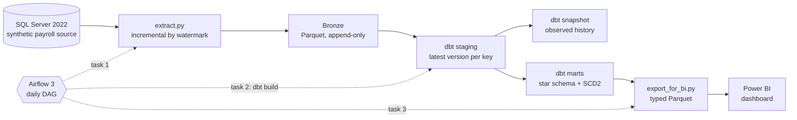
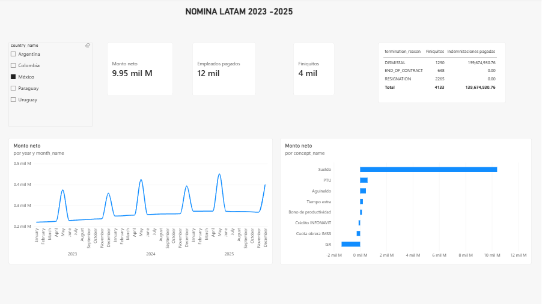

# LATAM Payroll Data Pipeline

An end-to-end batch data pipeline over a synthetic, multi-country payroll system: **SQL Server → incremental extraction to Parquet → dbt on DuckDB (staging, snapshot and a star schema with SCD Type 2) → Power BI**, orchestrated by Airflow 3 and running locally in Docker.

> All data in this repository is **synthetic**, generated with set-based T-SQL. No real payroll or personal data is used. Payroll rules (taxes, contributions, bonuses) are illustrative, not legally accurate calculations.

## At a glance

| | |
|---|---|
| Countries | 5 (MX, CO biweekly · AR, PY, UY monthly), each in its own currency |
| Volume | ~4.9 M payroll movements · 30,000 employees · 30,746 employments · 10,444 settlements · 144,551 absences |
| Payroll window | 2023–2025 (252 payroll periods) |
| Data model | 3 fact tables, 4 dimensions (one SCD Type 2) and a dbt snapshot |
| Data quality | 60 dbt data tests, including reconciliation tests between layers and one test per business rule |
| Incremental extract | Full load ~70 s → incremental run with no changes < 1 s |
| Orchestration | Daily Airflow DAG (extract → dbt build → BI export) with retries; a full run takes ~45 s |

## Architecture



| Layer | Technology | Responsibility |
|---|---|---|
| Source | SQL Server 2022 in Docker | Normalized OLTP schema (9 tables) with constraints and audit columns |
| Ingestion | Python, pandas, pyarrow, SQLAlchemy | Incremental extraction with explicit schema contracts |
| Bronze | Parquet files | Immutable, append-only history of every load |
| Transformation | dbt + DuckDB | Staging (deduplication, naming, formatting), intermediate models, snapshot and marts (dimensional model) |
| Serving | Python + DuckDB | Typed Parquet export for BI, decoupled from the dbt database |
| BI | Power BI (PBIP) | Dashboard; semantic model and report versioned as text |
| Orchestration | Airflow 3.3 in Docker | Scheduling, dependencies, retries |

## Data model

**Facts**

- `fct_payroll_movement` — grain: one payroll movement (employment × period × concept). Joined point-in-time to the employee version in effect when it was paid. Exposes both the raw `amount` and a `signed_amount` (earnings positive, deductions negative). Incremental: `delete+insert` with a 3-day lookback.
- `fct_settlement` — grain: one settlement (termination payout), with its lines pivoted into columns: vacation, indemnity, deductions and net amount.
- `fct_absence_day` — grain: one absence day per employment. Absence ranges are expanded to days; cancelled absences and days outside the employment are excluded; and overlapping absences are resolved with the HR priority rule (sick leave > vacation > unjustified), so every day is counted once.

**Dimensions**

- `dim_employee` — SCD Type 2: one row per salary version of each employment, with `valid_from`, `valid_to`, `is_current` and `history_truncated`, plus descriptive attributes such as `contract_type`.
- `dim_concept`, `dim_country`, `dim_date`.

**Snapshot**

- `snp_employment` — dbt snapshot (timestamp strategy): the history of employment changes as they are observed, from the first run onwards.

## Dashboard



Power BI report over the marts: net pay, employees paid and settlements per country (in local currency), filterable by country and contract type, plus an absenteeism page by department, month and absence type, in business and calendar days.

## Engineering decisions

**Incremental extraction with at-least-once delivery.** Each table is extracted by its `UpdatedAt` watermark. The upper bound is frozen before reading, loads are written to a hidden `_inprogress_` folder and published with a single rename, and the watermark only advances after a successful publish. A failed run repeats its window instead of skipping it: duplicates are possible and handled downstream; gaps are not.

**Append-only bronze, deduplicated in staging.** Bronze keeps every version of every row, partitioned by `load_id`. Staging models keep the latest version per primary key (`QUALIFY ROW_NUMBER() ...`), with ties broken deterministically by load.

**Explicit schema contracts.** Every source table has a declared Arrow schema (`extract/tables.py`). Money travels as `decimal128(18, 2)` from source to marts; nullability is enforced; a value that does not fit its contract fails the load loudly instead of being silently converted.

**Schema changes handled explicitly.** A new source column is not picked up silently: it is added to the contract, older Parquet files are read by column name, and existing rows are backfilled for that table only (`extract.py --table`) instead of re-extracting everything.

**SCD Type 2 rebuilt from transactions.** The source overwrites salaries in place, as many real systems do. Salary history is reconstructed from the base-salary payroll movements with a gaps-and-islands approach, and facts are joined to the version in effect at payment time.

**Honest about missing history.** For employees hired before the payroll window, earlier salary changes left no evidence. Instead of extrapolating, the first version starts at the first observed payroll and the record is flagged with `history_truncated` (17,876 employments).

**Change the grain when the question requires it.** The source stores absences as date ranges, one row per request. The mart stores one row per employment per day, so days crossing a month boundary land in the right month, overlaps can be detected by a unique key, and business days are a filter on the date dimension rather than a separate calculation.

**Captured history next to reconstructed history.** A dbt snapshot records employment changes as they are observed from now on, complementing the SCD2 rebuilt from transactions.

**Serving layer decoupled from the warehouse.** Power BI reads a Parquet export, never the dbt database: DuckDB allows a single writer, so a BI tool holding the file open would block the nightly build. The export is also a type contract: oversized integers and decimals are cast to types BI tools support, and the cast fails loudly if a value does not fit.

**Idempotency everywhere.** Every SQL script, extraction and dbt model can be re-run without duplicating data.

**Isolated runtimes.** The Airflow image runs the pipeline from its own virtual environment, installed from the same lockfile as local development, so orchestrator and pipeline dependencies never conflict.

**Least privilege.** The extractor connects with a read-only database user.

## Problems found and fixed

These are the issues that taught the most, kept here on purpose.

1. **A query optimizer silently dropped 14 of 46 generation rules.** Total volume came in ~10% below the estimate while every structural test passed. Profiling concept frequencies showed rules that were either fully present or entirely missing: SQL Server was evaluating a `RAND(CHECKSUM(NEWID()))` filter once per rule, before the join, instead of once per row. Fixed by correlating every random expression with columns from all joined tables. Lesson: structural tests do not catch distribution problems; profiling does.
2. **Silent decimal-to-float conversion.** `pandas.read_sql` converts `DECIMAL` to `float64` by default. Totals still matched to the cent at this volume, which made the bug easy to miss. Fixed by disabling the coercion and enforcing types through schema contracts. The same issue appeared again at the DuckDB-to-pandas boundary and was fixed there too.
3. **An SCD2 that invented history.** The first version of `dim_employee` claimed salaries had been in effect years before there was any evidence of them. Diagnosed as left censoring and fixed as described above.
4. **Simulated source outage.** With the source database down, the extraction task retried twice and failed; the dbt task was marked `upstream_failed` and never ran, so no mart was built on incomplete data. After restoring the source, only the failed task and its downstream were cleared and re-run on the same DAG run.
5. **A new source column the pipeline could not see.** A simulated application release added `ContractType` and back-filled it with direct `UPDATE`s that did not touch `UpdatedAt`, so the watermark extractor would never have picked up existing rows. On top of that, 31 values arrived as `'temporary '` (lowercase, trailing space): invisible in SQL Server, whose case-insensitive collation and trailing-space comparison grouped them with `TEMPORARY`, but distinct in DuckDB. Fixed with a single-table backfill, normalization in staging, `warn`-level tests for known source defects, and a one-off backfill of the snapshot's current versions only, leaving closed versions as unknown instead of inventing history. The application team now updates `UpdatedAt` in every data fix and added a CHECK constraint. Lesson: anything that detects change through `UpdatedAt` is blind to changes that bypass it; Change Data Capture is the structural fix.
6. **Absence days counted twice.** Profiling the new absence table showed 4,492 pairs of overlapping absences for the same employment (for example, a sick leave during a vacation, or the same vacation captured twice). Expanding the ranges to days and summing them would have overstated absenteeism by 10,235 days (1.6%). HR defined a priority rule; the mart keeps one row per employment per day, and a test fails if any day appears twice.

## Repository structure

```
.
├── docker-compose.yml        SQL Server + Airflow
├── sql/                      Source schema, synthetic data generator and simulated app releases (T-SQL)
├── tests/                    SQL data tests for the generator
├── extract/                  Incremental extractor and schema contracts
├── warehouse/                Hand-written silver/gold layer (reference, pre-dbt)
├── transform/                dbt project: staging, intermediate, snapshot and marts
├── serving/                  Typed Parquet export for BI
├── orchestration/            Airflow image and DAG
├── bi/                       Power BI project (PBIP: model and report as text)
└── docs/                     Images for this README
```

## Running it locally

**Prerequisites:** a Docker runtime (developed with Rancher Desktop), Python 3.13, the Microsoft ODBC Driver 18 for SQL Server and, for the dashboard, Power BI Desktop.

1. **Configure secrets.** Copy `.env.example` to `.env` and set the passwords.
2. **Start the source database.**
   ```bash
   docker compose up -d sqlserver
   ```
3. **Build and populate the source.** Run `sql/00_*` through `sql/10_*` in order (SSMS or `sqlcmd`, port `1434`). Scripts `08` to `10` simulate application releases (a new column with dirty data, its fix, and a new absence table); the current pipeline expects them.
4. **Create the read-only extraction user**, with the password from your `.env`:
   ```sql
   CREATE LOGIN extractor WITH PASSWORD = '<your-password>';
   USE LabNomina;
   CREATE USER extractor FOR LOGIN extractor;
   ALTER ROLE db_datareader ADD MEMBER extractor;
   ```
5. **Run the pipeline manually.**
   ```bash
   python -m venv .venv
   # activate the environment, then:
   pip install -r requirements.txt
   python extract/extract.py
   cd transform && dbt build && cd ..
   python serving/export_for_bi.py
   ```
6. **Or let Airflow run it.**
   ```bash
   docker compose build airflow
   docker compose up -d
   ```
   Open `http://localhost:8080`, unpause `payroll_pipeline` and trigger it.
7. **Open the dashboard.** Open `bi/payroll.pbip` in Power BI Desktop and refresh. The Parquet sources point to `C:\dev\personal\lab-de\data\serving\`; if you cloned the repository elsewhere, update the paths in *Transform data*.

## Roadmap

- CI with GitHub Actions running `dbt build` on every pull request, plus branch protection on `main`.
- Change Data Capture as an alternative to watermark extraction.
- A PySpark version of the transformation layer, to compare approaches at larger volumes.

## Author

**José Emmanuel Carrillo Ruiz** — Backend/data developer working on multi-country LATAM payroll platforms, building toward data engineering.
[LinkedIn](https://www.linkedin.com/in/emmanuel-carrillo-ruiz-43b2b9334)
