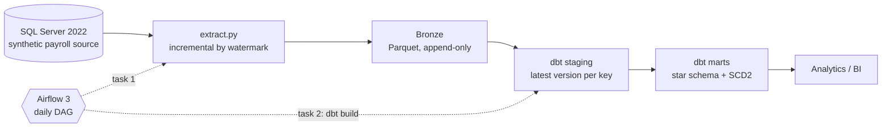

# LATAM Payroll Data Pipeline

An end-to-end batch data pipeline over a synthetic, multi-country payroll system: **SQL Server → incremental extraction to Parquet → dbt on DuckDB (staging and a star schema with SCD Type 2) → orchestrated by Airflow 3**, all running locally in Docker.

> All data in this repository is **synthetic**, generated with set-based T-SQL. No real payroll or personal data is used. Payroll rules (taxes, contributions, bonuses) are illustrative, not legally accurate calculations.

## At a glance

| | |
|---|---|
| Countries | 5 (MX, CO biweekly · AR, PY, UY monthly), each in its own currency |
| Volume | ~4.9 M payroll movements · 30,000 employees · 30,746 employments · 10,444 settlements |
| Payroll window | 2023–2025 (252 payroll periods) |
| Data model | 2 fact tables, 4 dimensions, including an SCD Type 2 employee dimension |
| Data quality | 42 dbt data tests, plus reconciliation tests between layers |
| Incremental extract | Full load ~70 s → incremental run with no changes < 1 s |
| Orchestration | Daily Airflow DAG with retries; a full run takes ~25 s |

## Architecture



| Layer | Technology | Responsibility |
|---|---|---|
| Source | SQL Server 2022 in Docker | Normalized OLTP schema (9 tables) with constraints and audit columns |
| Ingestion | Python, pandas, pyarrow, SQLAlchemy | Incremental extraction with explicit schema contracts |
| Bronze | Parquet files | Immutable, append-only history of every load |
| Transformation | dbt + DuckDB | Staging (deduplication, naming) and marts (dimensional model) |
| Orchestration | Airflow 3.3 in Docker | Scheduling, dependencies, retries |

## Data model

**Facts**

- `fct_payroll_movement` — grain: one payroll movement (employment × period × concept). Joined point-in-time to the employee version in effect when it was paid. Exposes both the raw `amount` and a `signed_amount` (earnings positive, deductions negative).
- `fct_settlement` — grain: one settlement (termination payout), with its lines pivoted into columns: vacation, indemnity, deductions and net amount.

**Dimensions**

- `dim_employee` — SCD Type 2: one row per salary version of each employment, with `valid_from`, `valid_to`, `is_current` and `history_truncated`.
- `dim_concept`, `dim_country`, `dim_date`.

## Engineering decisions

**Incremental extraction with at-least-once delivery.** Each table is extracted by its `UpdatedAt` watermark. The upper bound is frozen before reading, loads are written to a hidden `_inprogress_` folder and published with a single rename, and the watermark only advances after a successful publish. A failed run repeats its window instead of skipping it: duplicates are possible and handled downstream; gaps are not.

**Append-only bronze, deduplicated in staging.** Bronze keeps every version of every row, partitioned by `load_id`. Staging models keep the latest version per primary key (`QUALIFY ROW_NUMBER() ...`), with ties broken deterministically by load.

**Explicit schema contracts.** Every source table has a declared Arrow schema (`extract/tables.py`). Money travels as `decimal128(18, 2)` from source to marts; nullability is enforced; a value that does not fit its contract fails the load loudly instead of being silently converted.

**SCD Type 2 rebuilt from transactions.** The source overwrites salaries in place, as many real systems do. Salary history is reconstructed from the base-salary payroll movements with a gaps-and-islands approach, and facts are joined to the version in effect at payment time.

**Honest about missing history.** For employees hired before the payroll window, earlier salary changes left no evidence. Instead of extrapolating, the first version starts at the first observed payroll and the record is flagged with `history_truncated` (17,876 employments).

**Idempotency everywhere.** Every SQL script, extraction and dbt model can be re-run without duplicating data.

**Isolated runtimes.** The Airflow image runs the pipeline from its own virtual environment, installed from the same lockfile as local development, so orchestrator and pipeline dependencies never conflict.

**Least privilege.** The extractor connects with a read-only database user.

## Problems found and fixed

These are the issues that taught the most, kept here on purpose.

1. **A query optimizer silently dropped 14 of 46 generation rules.** Total volume came in ~10% below the estimate while every structural test passed. Profiling concept frequencies showed rules that were either fully present or entirely missing: SQL Server was evaluating a `RAND(CHECKSUM(NEWID()))` filter once per rule, before the join, instead of once per row. Fixed by correlating every random expression with columns from all joined tables. Lesson: structural tests do not catch distribution problems; profiling does.
2. **Silent decimal-to-float conversion.** `pandas.read_sql` converts `DECIMAL` to `float64` by default. Totals still matched to the cent at this volume, which made the bug easy to miss. Fixed by disabling the coercion and enforcing types through schema contracts. The same issue appeared again at the DuckDB-to-pandas boundary and was fixed there too.
3. **An SCD2 that invented history.** The first version of `dim_employee` claimed salaries had been in effect years before there was any evidence of them. Diagnosed as left censoring and fixed as described above.
4. **Simulated source outage.** With the source database down, the extraction task retried twice and failed; the dbt task was marked `upstream_failed` and never ran, so no mart was built on incomplete data. After restoring the source, only the failed task and its downstream were cleared and re-run on the same DAG run.

## Repository structure

```
.
├── docker-compose.yml        SQL Server + Airflow
├── sql/                      Source schema and synthetic data generator (T-SQL)
├── tests/                    SQL data tests for the generator
├── extract/                  Incremental extractor and schema contracts
├── warehouse/                Hand-written silver/gold layer (reference, pre-dbt)
├── transform/                dbt project: staging and marts
└── orchestration/            Airflow image and DAG
```

## Running it locally

**Prerequisites:** a Docker runtime (developed with Rancher Desktop), Python 3.13, and the Microsoft ODBC Driver 18 for SQL Server.

1. **Configure secrets.** Copy `.env.example` to `.env` and set the passwords.
2. **Start the source database.**
   ```bash
   docker compose up -d sqlserver
   ```
3. **Build and populate the source.** Run `sql/00_*` through `sql/07_*` in order (SSMS or `sqlcmd`, port `1434`).
4. **Create the read-only extraction user**, with the password from your `.env`:
   ```sql
   CREATE LOGIN extractor WITH PASSWORD = '<your-password>';
   USE LabNomina;
   CREATE USER extractor FOR LOGIN extractor;
   ALTER ROLE db_datareader ADD MEMBER extractor;
   ```
5. **Run the pipeline manually.**
   ```bash
   python -m venv .venv
   # activate the environment, then:
   pip install -r requirements.txt
   python extract/extract.py
   cd transform && dbt build
   ```
6. **Or let Airflow run it.**
   ```bash
   docker compose build airflow
   docker compose up -d
   ```
   Open `http://localhost:8080`, unpause `payroll_pipeline` and trigger it.

## Roadmap

- dbt snapshots to capture source changes as they happen, and incremental models for the large fact table.
- A Power BI dashboard on top of the marts.
- CI with GitHub Actions running `dbt build` on every pull request.
- Change Data Capture as an alternative to watermark extraction.

## Author

**José Emmanuel Carrillo Ruiz** — Backend/data developer working on multi-country LATAM payroll platforms, building toward data engineering.
[LinkedIn](https://www.linkedin.com/in/emmanuel-carrillo-ruiz-43b2b9334?utm_source=share_via&utm_content=profile&utm_medium=member_android)
